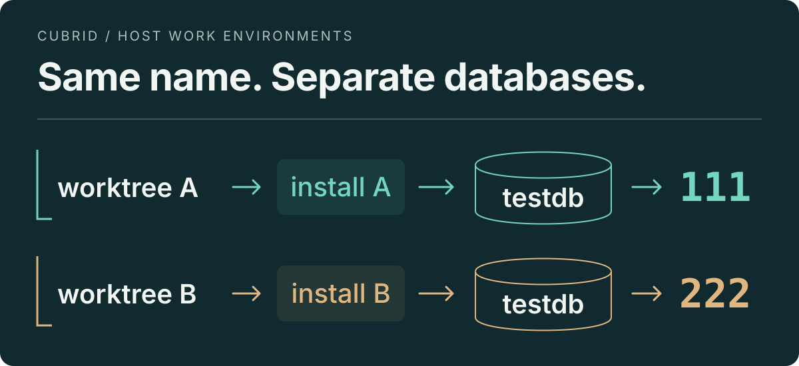

# cubrid-workenv

Prepare a dedicated CUBRID host environment for each source worktree, then use
ordinary `cubrid` and `csql` commands.

<p align="center">
  
</p>

**Same database name, different data.** In the [recorded coexistence check](tests/evidence/ticket09-coexistence/results.json),
A read `111` and B read `222` through csql and JDBC. B continued working after
A's server and broker stopped. [See the verification report →](docs/evidence/ticket09-workflow.md)

[Why this exists](#why-this-exists) · [How it works](#how-cubrid-workenv-solves-it) · [Get started](#get-started) · [Commands](#commands) · [Evidence](#verification) · [Limitations](#scope-and-limitations) · [Future work](#suggested-improvements)

## Why this exists

A developer or agent may leave a database running in worktree A while testing
another CUBRID branch in worktree B. **Git separates the source files; host
runtime resources still need their own configuration.** With overlapping settings,
B's commands can reach A's master and its same-named `testdb`, or a broker stop
can affect the other environment.

An unintended connection can invalidate an experiment: a query intended to
check B's changes may actually run against A's server. Resource interference
can interrupt another experiment or force developers to wait for long tests
before starting their own work.

The causes span several resources. Master and broker ports, broker shared-memory
keys, database registries, and master/PL socket paths can overlap. PL also writes
information files inside the installation. Shell commands select these through
environment variables and configuration, so inherited or partially switched
settings can select the wrong instance. Changing only the DB name or one port
leaves other conflicts unresolved. The [source investigation](docs/handoff-instance-isolation.md)
maps those relationships.

There was a second workflow problem: the previous shared direnv loader ran full
runtime validation on directory entry. Repeated filesystem comparisons,
installation hashing, and host inspection made routine shell entry expensive.
See the [original tooling observations](.scratch/workenv/design-interview.md#existing-tooling-facts).

### Ways to address it

| Approach | Trade-off |
| --- | --- |
| Run host environments one at a time | Stop and switch between runs; long tests block other work. |
| Configure each host environment manually | Coordinate installations, registries, ports, IPC keys, and socket paths for every worktree. |
| Use separate containers | Separate runtime namespaces and manage mounts/storage through a container workflow. |

`cubrid-workenv` automates the coordinated host configuration while keeping
ordinary native commands available. It also separates one-time preparation from
everyday shell entry.

## How cubrid-workenv solves it

1. **Prepare explicitly.** After build and installation, `init` records a dedicated
   installation and preset, writes worktree-local configuration and a database
   registry, and prepares `testdb` unless `--no-db` is selected.
2. **Allocate resources together.** A shared host allocation registry assigns
   distinct master/broker ports and broker SysV shared-memory keys. Each worktree
   gets a short TMP directory for master and PL sockets. Dedicated installations
   keep installation-local PL files separate too.
3. **Load one consistent selection.** The generated `env.sh` clears inherited
   CUBRID overrides and selects the installation, configuration, registry, and
   runtime resources together. Native `cubrid` and `csql` then use that selection.
4. **Keep routine entry lightweight.** Loading checks readiness without creating
   DBs or running full diagnosis. Repeating `init` on a ready environment is a
   no-op; explicit, read-only `doctor` handles deeper inspection.

Settings, state, utility logs, and the Bash loader live in `.cub-workenv/`.
New databases use `.cub-workenv/db/` unless you select external storage.
Development-tool paths remain available when the selected CUBRID paths are loaded.

Keep cooperating environments in the **same host allocation namespace**.
It defaults to `${XDG_STATE_HOME:-$HOME/.local/state}/cub-workenv`.
Stopped environments retain their assignments; allocation avoids recorded and
currently occupied resources. It is not a lasting OS reservation.

For pool ranges, storage defaults, direnv integration, and recovery, follow the
[complete workflow](docs/workflow.md).

## Get started

Requires **Linux, Python 3.10+, and Bash**. With [uv](https://docs.astral.sh/uv/)
installed, run from this checkout to install or refresh the CLI:

```sh
just sync
cub-workenv --help
```

`just install` is an alias. Without just, use `uv tool install --reinstall .`.

**Build and install CUBRID first.** Choose an installation dedicated to this
worktree. `--preset` records your selected build label; initialization does not
configure, build, or install CUBRID.

```sh
cub-workenv init --worktree /path/to/source \
  --install /path/to/dedicated/install --preset debug_gcc
source /path/to/source/.cub-workenv/env.sh

cubrid server start testdb
csql -C -u dba -c 'select 42;' testdb
cubrid server stop testdb
```

The query should return `42`. Initialization creates `testdb` by default.
PL uses the installation's default Java unless `--java-home` or `JAVA_HOME`
selects a compatible JDK at initialization.

<details>
<summary>Installation paths and updates</summary>

`just sync` installs an independent command with `uv tool install --reinstall .`;
source changes take effect after the next sync. It also replaces the legacy
launcher symlink from this checkout while preserving unrelated files and links.

If needed, add uv's command directory to your PATH. The usual default is
`~/.local/bin`:

```sh
export PATH="$HOME/.local/bin:$PATH"
```

In Nushell, use `path add ~/.local/bin`. Set `CUB_WORKENV_BIN_DIR=/your/bin`
or `UV_TOOL_BIN_DIR=/your/bin` when installing to select another directory.
You can also run `bin/cub-workenv` directly from the checkout.

</details>

## Commands

| Command | Purpose |
| --- | --- |
| `init` | [Prepare an environment](docs/workflow.md#first-use); `--no-db` defers `testdb` creation. |
| `create-db NAME` | [Add a database](docs/database-selection.md); `--path` selects external storage. |
| `env` | [Emit Bash](docs/workflow.md#first-use) to load a ready environment and check expected selections. |
| `doctor` | [Inspect selection, storage, and ownership](docs/doctor.md) without changing them. |
| `reset` / `reset-all` | [Preview release of ports and SHM assignments](docs/reset.md) for reinitialization. |
| `prune` | [Preview removal of missing linked worktree registrations](docs/prune.md) and their idle allocations. |

For example, add a database or check the expected selection:

```sh
cub-workenv create-db example --worktree /path/to/source
cub-workenv doctor --worktree /path/to/source \
  --install /path/to/dedicated/install --preset debug_gcc
```

`reset`, `reset-all`, and `prune` apply changes only with `--apply`, after
inactivity checks. They do not stop processes or delete database storage.

## Verification

The main integrated native run used **CUBRID 11.5.0.2635-30043f4**, built from
source commit `30043f492225c8350aa15455dc329c87227b5fdf`, with **Java 8** on Linux
and local filesystems. The [verification report](docs/evidence/ticket09-workflow.md)
preserves commands, versions, hashes, outcomes, interrupted attempts, and cleanup.
These are observations of the recorded revisions, not qualification of every
later revision or deployment.

| Evaluated behavior | Recorded observation |
| --- | --- |
| Independent environments | csql, JDBC, and PL remained usable in B after A's server and broker stopped. [Coexistence evidence](tests/evidence/ticket09-coexistence/results.json) |
| Environment selection | A→B switching selected the intended instance; repeated entry omitted initialization and full diagnosis. [Loader evidence](docs/evidence/ticket07-environment.md) |
| Shared physical storage | Competing server and standalone opens were rejected; normal shutdown permitted sequential reuse. [Native evidence](tests/evidence/ticket09-shared/results.json) |
| Read-only diagnosis | Protected artifact hashes, live PIDs, and socket metadata remained unchanged. [Doctor evidence](tests/evidence/ticket09-doctor/results.json) |
| Database lifetime | The fixture preserved external data/log/LOB storage through worktree removal. [Lifetime evidence](tests/evidence/ticket09-lifetime/results.json) |

The recorded source-build `ctest` invocation reported **No tests were found**;
it establishes no engine unit-test coverage. Some CLI suites stub native
utilities, including the [reset](docs/reset.md#verification) and
[prune](docs/prune.md) fixtures. Their results establish CLI/resource behavior,
not database-engine compatibility.

Run the CLI test suite from this checkout:

```sh
python3 -m unittest discover -s tests -v
```

Native acceptance scripts and their reproduction commands are documented in the
[verification report](docs/evidence/ticket09-workflow.md#cleanup-and-reproduction).
For development context, see the [specification](.scratch/workenv/spec.md),
[native locking experiment](experiments/native-db-exclusion/README.md),
[allocation reclamation](docs/allocation-reclamation.md), and [handoff](HANDOFF.md).

## Scope and limitations

- **Cooperative host configuration.** Allocation checks known assignments and
  current occupancy during initialization. All cooperating environments must use
  the same allocation namespace and host resource namespaces. There is no lasting
  OS reservation, sandbox, or protection from later outside interference or broad
  process termination by a test runner.
- **Partial diagnostic visibility.** Process permissions, PID changes, and namespace
  boundaries limit ownership inspection. `doctor` observes a changing system;
  its result is not an atomic snapshot or a runtime lease. Unconfirmed ownership
  requires manual inspection. See [diagnosis](docs/doctor.md).
- **Bounded native-locking evidence.** Shared physical storage requires sequential
  independent opening and enabled native locking. Ordinary clients may connect
  to the running server. Simultaneous first-opener races, disabled locking,
  arbitrary utilities, crash recovery, and network filesystems remain unverified.
  Registration checks do not establish DB health or file-format compatibility.
  See [DB selection](docs/database-selection.md).
- **Limited compatibility and service scope.** Native results cover the recorded
  Linux builds and JDK selections. Cross-version DB compatibility is not established;
  Java 21 failed PL startup in an earlier experiment. Generated settings cover a
  server, one `workenv` broker, and PL over Unix sockets. HA, CUBRID Manager, and
  container execution are outside this tool's scope.
- **Explicit recovery and storage management.** Failed initialization retains
  stage, allocation, logs, and DB evidence. There is no automatic repair, takeover,
  format conversion, or backup. [Manual recovery](docs/workflow.md#diagnose-and-recover-deliberately)
  and [worktree removal](docs/database-lifetime.md) require ownership and storage
  checks; external data, logs, and LOB targets must be preserved.
- **Finite resources and stable paths.** Stopped environments retain assignments;
  port/SHM pools can exhaust. Dedicated installations consume disk space, and Unix
  socket paths have length constraints. Worktree relocation and renaming are
  unsupported. [Reclamation](docs/allocation-reclamation.md) releases only proven-idle
  deleted worktrees; uncertain owners remain recorded.
- **Limited performance evidence.** Entry timings are host-specific observations,
  not an SLA. The recorded old/new comparison used build-only fixtures and does
  not establish a speedup over an initialized legacy environment.
  See [timings and limits](docs/evidence/ticket07-environment.md#timings-and-limits).

Installing this CLI does not apply companion personal-tooling changes or restow
existing source trees. Review that integration separately. The `cubrid-box`
container workflow remains independent of host initialization.

## Suggested improvements

These are proposed follow-ups, not implemented features or compatibility promises:

1. **Broaden compatibility evidence.** Run the native acceptance scripts across
   selected CUBRID/JDK combinations and publish a matrix with exact revisions,
   failures, and supported operations.
2. **Benchmark ready-environment loading.** Compare equivalent initialized
   environments on the same host, vary retained worktree counts, and report
   median and tail latency separately from initialization cost.
3. **Expand failure and recovery experiments.** Exercise interrupted preparation,
   simultaneous first openers, and abnormal shutdown in disposable fixtures;
   document observed recovery boundaries without assuming general automatic repair.
4. **Provide structured diagnostics.** A versioned machine-readable `doctor`
   result could let agents and CI consume selection, resource ownership, and
   visibility limits while preserving read-only behavior and human-readable output.
